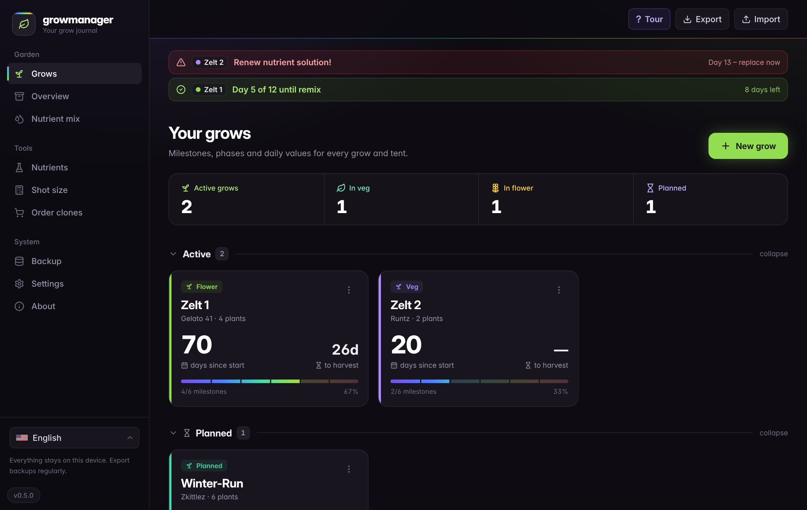
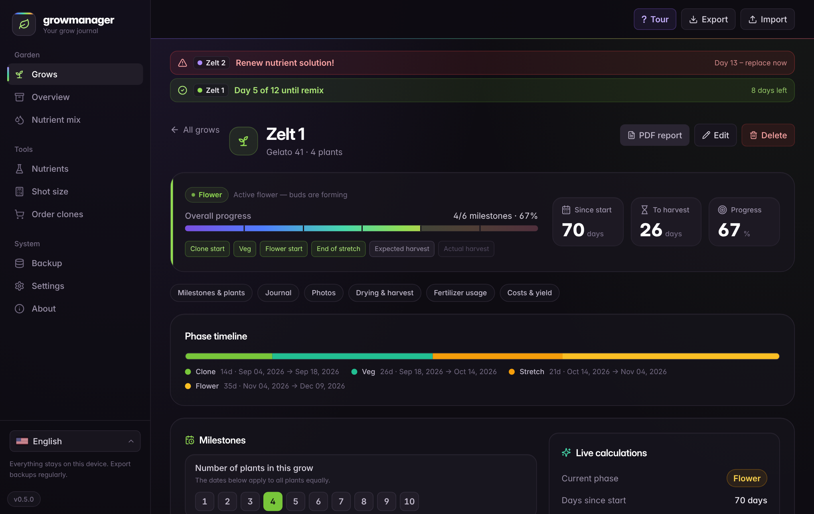
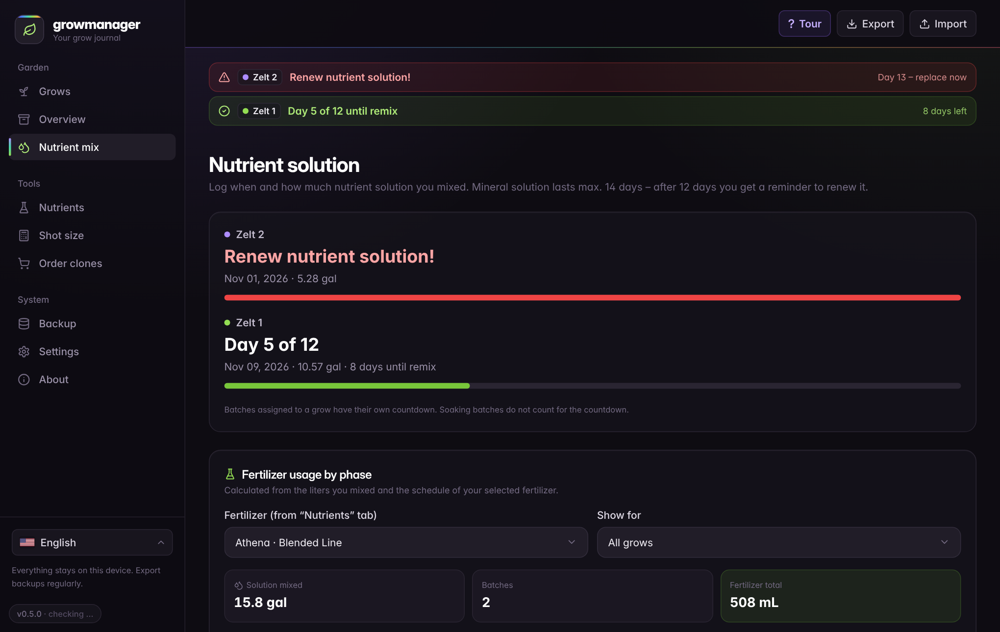

# growmanager

**Current version: 0.5.0** · [Download the latest release](https://github.com/elkarbeenus/growmanager/releases/latest)

**Your personal grow manager – plan every grow, track nutrients, costs and yield, and keep everything on your own device.**

growmanager is an offline desktop app (Linux AppImage and Windows installer) for home growers. It combines a grow journal, nutrient solution tracking, fertilizer schedules, automatic cost calculation (fertilizer and electricity), yield analysis, PDF reports and safe backups in one place. It is available in **English and German**, and no account or cloud is needed – all data stays on your computer.

## Screenshots







## Design

Version 0.5 brings a completely new look, built around the idea of a **grow tent at night**:

- dark plum tones (like Mylar under LED light), leaf green for actions, LED violet as the second colour and amber for flower and harvest,
- a **sidebar** on the left, grouped into *Garden*, *Tools* and *System* (a top bar in small windows),
- a **light-spectrum strip** on every grow that lights up further with each milestone reached,
- bundled fonts (Inter / Inter Display), so the app looks the same offline on Linux, SteamOS and Windows.

## Features

### Grows & journal
- Create grows with name, strain and **1–10 plants**. Start date and milestones apply equally to all plants of a grow.
- Track milestones (clone start, veg, flower, end of stretch, expected and actual harvest) with an automatic phase timeline and progress.
- Keep a daily journal: pH, EC, temperature, humidity, watering amount, nutrient flag and notes.
- Grows are sorted into **Active**, **Planned** and **Past grows** (by year); a "Pending" counter shows planned grows without distorting your active numbers.
- Record drying data and the harvest amount.
- Attach **photos** to every grow – they are stored as a copy inside the app and included in backup files, so they stay visible even if the original file is moved or deleted.

### Nutrient solution & fertilizer
- Log every batch of nutrient solution (date and liters) and mark it as **use** or **soaking**. A timer reminds you when to mix a fresh batch – **separately for every grow** the batch is assigned to; soaking batches do not count for the countdown.
- Choose your fertilizer: Athena (Blended Line, manufacturer values – no Bloom A/B in flower weeks 8 and 9), Hesi, Plagron, Biobizz and Advanced Nutrients (guideline values). Doses are shown in **mL per gallon** (English) or **mL per 10 L** (German).
- See your **fertilizer usage in mL per product, split by phase** (veg / flower), plus the liters of solution mixed – per grow or for all grows. Batches are matched to the right grow and schedule week automatically, or you can set them by hand.

### Costs & yield – calculated automatically
- **Fertilizer costs** are calculated from your usage (mL per product × price per liter). Average prices are preset and can be adjusted to your own.
- **Electricity costs** are calculated from your LED lamp, light hours, electricity price and the other devices in the tent (exhaust fan, clip fan, grow controller, dehumidifier, humidifier) – each with its own power and run time. For dehumidifiers and humidifiers you can set the **hours per day and number of weeks per grow**.
- Add manual costs for everything else (equipment, substrate, seeds/clones, other).
- Get total cost, cost per plant, yield per plant and **cost per gram** for every grow.
- The **Overview** tab compares all grows with a year filter and charts.

### Settings
- Enter your **electricity price (€/kWh)** and light hours (default 18 h veg / 12 h flower) once.
- Add your **LED lamps** (with a **dimming profile**: by default 40 % in veg, 60 % at the start of the stretch rising to 100 % by the end of the stretch (flower) – adjustable per lamp and with **sliders for every grow**) and **other devices** with model and watts; choose per grow which ones are used.

### PDF reports
- Create a PDF report for a single grow or an overview of all grows.
- Preview the report in a pop-up first and save it only if you like it.
- The report includes milestones, costs, fertilizer usage by phase and the journal with charts.

### Crop steering calculator
- Enter your medium size and get the shot size for **vegetative** and **generative** steering in % and mL.

### Backups & safety
- Everything is stored **locally**. No account, no cloud.
- Automatic daily backups (14 days kept), manual backups, JSON export/import and "Save as…" to a folder of your choice; the app shows where each backup is stored.
- **Quick rollback** to one of the last two backups – with a preview of what would be lost.
- **Imports ask first** and show a short summary of what was added, changed or removed. A **safety backup** is created automatically before every import, restore or reset.
- **Reset everything** in the About tab brings the app back to a fresh state (confirmed by typing `RESET`).

### Convenience
- **Order clones** tab with links to clone shops that open in your default browser.
- The app **remembers your layout** (tab, open grow, collapsed sections, scroll position, window size) and asks to make a backup when you close it with unsaved changes.
- Optional **hardware acceleration** on Linux for smooth scrolling, with automatic fallback to safe mode.
- A short **guided tour** explains where to find what – the sidebar, the header buttons and every tab. It runs once and can be switched off or restarted at any time. Hint cards can be dismissed.
- English and German, liters and gallons.
- Dark interface for use in low light.

## Downloads

Ready-made builds are attached to each release:

- **Linux / SteamOS:** AppImage (and .deb)
- **Windows:** setup `.exe`

Go to **[Releases](https://github.com/elkarbeenus/growmanager/releases)** and download the latest version. The app tells you on start when a new version is available.

## Versioning

growmanager is in its 0.x phase: every release raises the patch number (0.5.0 → 0.5.1 → 0.5.2 …) until version **1.0**. Test builds are published as pre-releases (`v0.5.1-test.1`) and are not offered as updates.

## Tech stack

React, TypeScript, Vite, Tailwind CSS and Tauri. PDF reports are created with pdf-lib. Builds for Linux and Windows are created automatically with GitHub Actions.

## Development

```bash
npm install
npm run dev        # web development
npm run build      # production build
npx tauri dev      # desktop app (requires Rust)
npx tauri build    # installer for your current system
```

When the version is raised, update `package.json`, `package-lock.json`, `src-tauri/tauri.conf.json` and `src-tauri/Cargo.toml`, add a `## vX.Y.Z` section to both changelogs and to `CHANGELOG` in `src/lib/appInfo.ts`, then push a tag `vX.Y.Z`. GitHub Actions builds Linux and Windows and publishes the release with the patch notes from `CHANGELOG.md`.

Every push to a branch also runs a quick check (typecheck, lint, web build).

## Disclaimer

Fertilizer values (except the official Athena values) and all prices are simplified guideline values. Please compare them with the manufacturer's current feeding chart and your real prices before relying on them. Electricity and cost figures are calculations based on your input, not measurements.

See `CHANGELOG.md` (German) and `CHANGELOG.en.md` (English) for patch notes.

Created with Bolt.new and Git.
