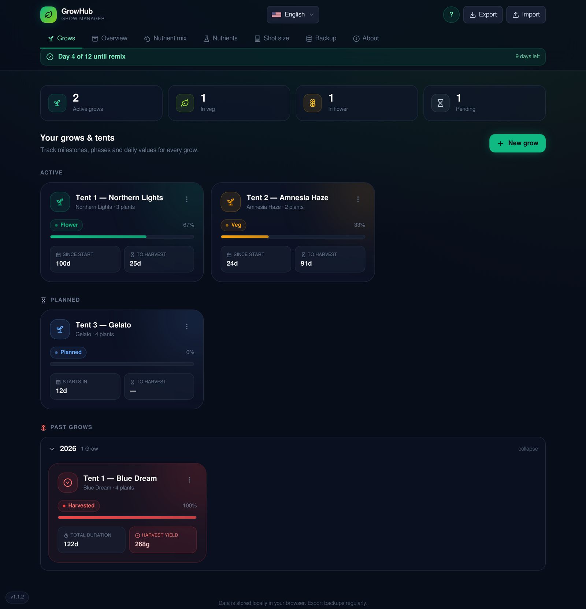
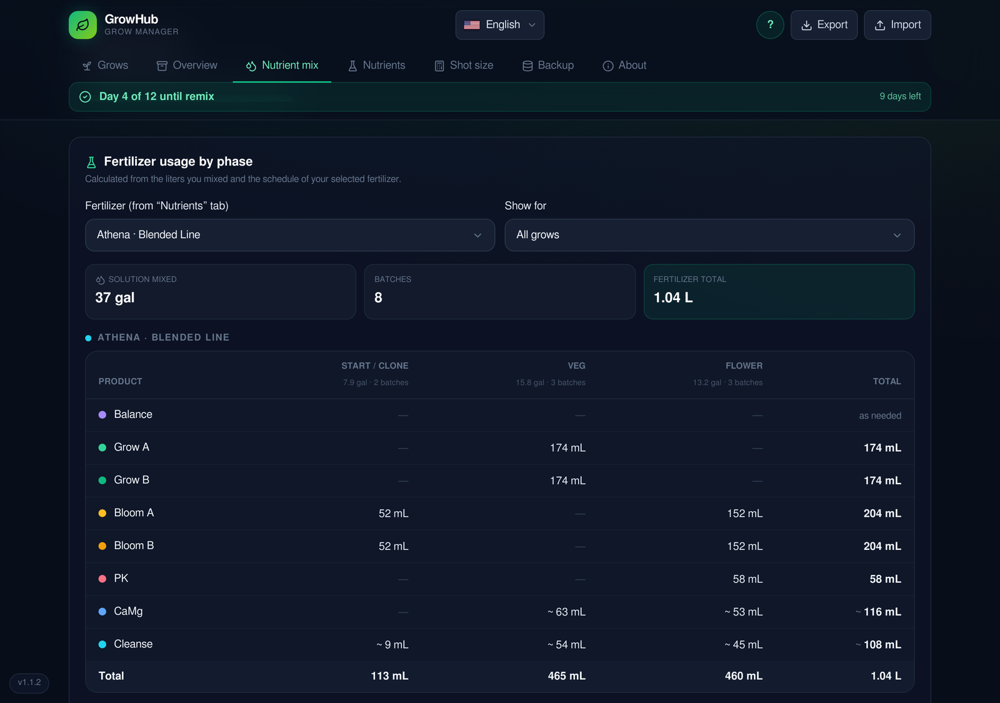

# growmanager

**A personal grow manager for tracking your plants, nutrients, costs and yield. It runs offline as a desktop app and keeps all data on your device.**

growmanager helps you plan and document every grow from the first clone to the final harvest. It combines a grow journal, nutrient solution tracking, fertilizer schedules, cost and yield analysis and PDF reports in one app. It is available in English and German.

## Screenshots





## What it does

### Grows & journal
- Create grows with name, strain and **1–10 plants**. Start date and milestones apply equally to all plants of a grow.
- Track milestones (clone start, veg, flower, end of stretch, expected and actual harvest) with an automatic phase timeline and progress.
- Keep a daily journal: pH, EC, temperature, humidity, watering amount, nutrient flag and notes.
- Grows are sorted into **Active**, **Planned** and **Past grows** (by year). A "Pending" counter shows planned grows without distorting your active numbers.
- Record drying data and the harvest amount.

### Nutrient solution & fertilizer
- Log every batch of nutrient solution (date and liters). A timer reminds you when it is time to mix a fresh batch.
- Choose your fertilizer: Athena (Blended Line, manufacturer values), Hesi, Plagron, Biobizz and Advanced Nutrients (guideline values). Doses are shown in **mL per gallon** (English) or **mL per 10 L** (German).
- See your **fertilizer usage in mL per product, split by phase** (veg / flower), plus the liters of solution you mixed. Batches are matched to the right grow and schedule week automatically, or you can set them by hand.

### Costs & yield
- Record costs per grow (nutrients, electricity, equipment, substrate, seeds/clones, other).
- Get cost per plant, yield per plant and **cost per gram** for every grow.
- The **Overview** tab compares all grows with a year filter and charts.

### PDF reports
- Create a PDF report for a single grow or an overview of all grows.
- Preview the report in a pop-up first and save it only if you like it.
- The report includes milestones, costs, fertilizer usage and the journal with charts.

### Crop steering calculator
- Enter your medium size and get the shot size for **vegetative** and **generative** steering in % and mL.

### Backups & privacy
- Everything is stored **locally**. No account and no cloud.
- Automatic daily backups (14 days kept), manual backups, JSON export/import and "Save as…" to a folder of your choice.
- A built-in overview shows where each backup is stored.
- Imports ask for confirmation and show a short summary of what was added, changed or removed. A safety backup is created automatically before every import, restore or reset.
- A **Reset everything** button in the About tab brings the app back to a fresh state (confirmed by typing `RESET`).

### Convenience
- A short guided tour explains where to find what. It runs once and can be switched off or restarted at any time.
- English and German, with liters and gallons.
- Dark interface for use in low light.

## Downloads

Ready-made builds are attached to each release:

- **Linux:** AppImage
- **Windows:** setup `.exe`

Go to **Releases** and download the latest version.

## Tech stack

React, TypeScript, Vite, Tailwind CSS and Tauri. Builds for Linux and Windows are created automatically with GitHub Actions.

## Development

```bash
npm install
npm run dev        # web development
npm run build      # production build
npx tauri dev      # desktop app (requires Rust)
npx tauri build    # installer for your current system
```

When the version is raised, update `package.json`, `src-tauri/tauri.conf.json`, `src-tauri/Cargo.toml` and the `tagName` / `releaseName` in `.github/workflows/main.yml`.

## Disclaimer

Fertilizer values (except the official Athena values) are simplified guideline values. Please always compare them with the manufacturer's current feeding chart before using them.

See `CHANGELOG.md` for patch notes.

Created with Bolt.new and Git.
